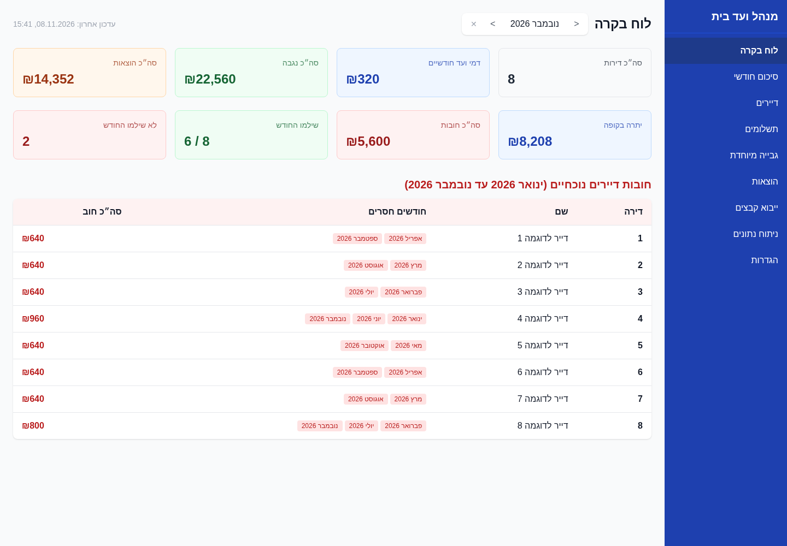
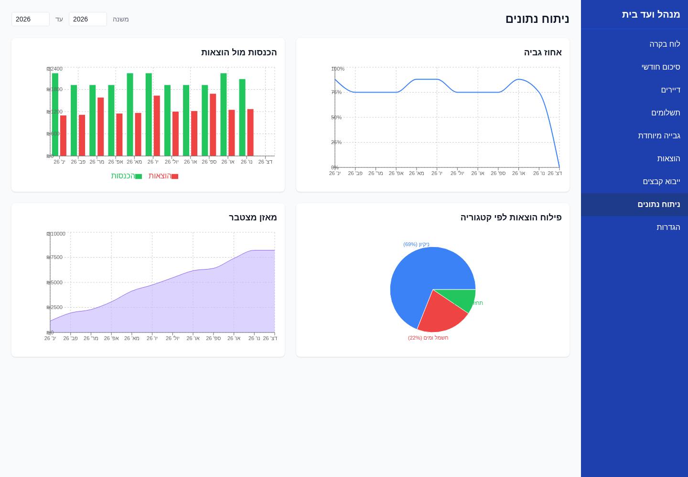
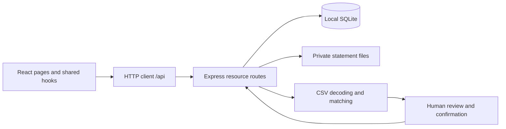

# Building Fund Manager

A full-stack application for Israeli building committees (ועד בית) to reconcile resident payments, track shared expenses, and understand the building's finances. The interface is in Hebrew, with right-to-left layout and Israeli shekel amounts.

The central workflow is turning a bank statement into reviewed financial records: import a CSV, map its columns, inspect suggested resident/category matches, and confirm the transactions. Manual entry remains available for payments and expenses that do not come from an import.

## What it does

- Monthly and yearly dashboards with collections, expenses, payment status, and debt summaries.
- Apartments, residents, ownership history, and a per-apartment payment timeline.
- Monthly payments, transfers covering multiple months, historical fee changes, and special-purpose funds.
- Categorized expenses, recurring-expense definitions, search, sorting, bulk approval/deletion, and CSV exports.
- Bank Hapoalim CSV import, UTF-8/Windows-1255 decoding, column mapping, duplicate checks, and saved matching aliases.
- Collection, income/expense, category, and running-balance charts.

## Screenshots

All records shown below are generated examples. No real residents, accounts, or bank statements are included.





## Architecture



During development, Vite proxies `/api` to the loopback-only Express server. In a compiled local build, Express serves both the frontend and the API. There is no external database or cloud service dependency.

| Area | Implementation |
| --- | --- |
| Frontend | React 18, TypeScript, React Router 7, Tailwind CSS, Recharts |
| Backend | Node.js, Express 4, TypeScript; resource-oriented HTTP routes |
| Persistence | SQLite through better-sqlite3; original uploaded CSV files on disk |
| Import | PapaParse, iconv-lite, deterministic Hebrew-aware name matching |
| Tooling | Vite 8, ESLint 9, Vitest 5, Testing Library, Supertest, Playwright |

The frontend keeps server results and form state within each page using React state and effects. Shared hooks implement selection, sorting, and text filtering. A modal context centralizes asynchronous confirmations and alerts. HTTP calls go through `client/src/api.ts`; its generic request wrapper is shared, although many endpoint payloads still use `any` rather than shared contracts.

The backend uses parameterized SQL and transactions for grouped database writes. Foreign keys express relationships and deletion behavior. The schema includes apartments, monthly payments, expenses, ownership/fee histories, matching aliases, special funds, and upload metadata.

## Engineering details

**Payment date and covered month are separate.** A transfer can cover several months; it is split into one payment record per covered month. This makes monthly reporting straightforward, while historical fee schedules let expected amounts change over time. Ownership history supports debt reporting across resident changes.

**Import suggestions remain reviewable.** Matching checks confirmed aliases first, then normalized exact and substring matches. Hebrew final-form letters and whitespace are normalized. These are deterministic rules, not machine learning. Suggested matches and month assignments are reviewed before writes are confirmed.

**Bank references are not globally unique.** Import duplicate checks pair a reference with its transaction date and check the relevant payment/expense records. This reduces false positives from references reused across statements; rows without references cannot use this safeguard.

**SQLite fits the local workflow.** Synchronous queries, schema initialization on startup, and a single local database keep setup small. The trade-off is a single-process design with manual schema migrations, rather than a service intended for concurrent remote users.

[Engineering notes](docs/engineering.md) connect these behaviors to the code and describe limitations worth discussing or improving.

## Run locally

Use **Node.js 24 LTS** (`nvm use` reads `.nvmrc`) and npm. Python and a C/C++ toolchain may be needed if better-sqlite3 cannot use a prebuilt binary. No API key or environment file is required.

From the project directory:

```bash
npm ci --ignore-scripts
npm ci --prefix server
npm ci --prefix client

# Optional: artificial demo data, BEFORE the first server start
npm run demo:seed

npm run dev
```

Open <http://localhost:5173>. The API listens on `127.0.0.1:3001`. The demo command refuses to run if a database already exists; it never resets an existing installation. Skip it to start with an empty application.

For an empty installation, set the monthly fee in **הגדרות** (Settings), add apartments in **דיירים** (Residents), then enter transactions or import a CSV from **העלאת קובץ** (Upload). Imported suggestions need review before confirmation.

To run the compiled application locally:

```bash
npm run build
npm start
```

Open <http://127.0.0.1:3001>. The root build compiles both packages. `.env.example` documents the fixed ports and paths; the application does not load `.env` configuration.

## Evaluate the code

| Start here | What to inspect |
| --- | --- |
| [`client/src/pages/Upload.tsx`](client/src/pages/Upload.tsx) | Multi-step import UI and review state |
| [`client/src/api.ts`](client/src/api.ts) | HTTP boundary and endpoint functions |
| [`client/src/hooks/`](client/src/hooks/) | Reusable selection, filtering, and sorting |
| [`server/src/db.ts`](server/src/db.ts) | Schema, relationships, defaults, migrations |
| [`server/src/routes/upload.ts`](server/src/routes/upload.ts) | Matching, duplicate checks, transactional confirmation |
| [`server/src/name-matcher.ts`](server/src/name-matcher.ts) | Hebrew normalization and match precedence |
| [`server/src/routes/dashboard.ts`](server/src/routes/dashboard.ts) | Fee history, collections, and debt calculation |
| [`server/src/security.ts`](server/src/security.ts) | Local host/origin boundary and browser protections |

```bash
npm run lint
npm test
npm run build

# Browser tests start their own development servers
cd client
npx playwright install chromium
cd ..
npm run test:e2e
```

Vitest covers server parsing/matching/routes/security and client hooks/components/API behavior. Server route tests use in-memory SQLite; browser tests use the real local API and database. Run browser tests in a disposable copy, never an installation containing personal records.

A proposed GitHub Actions workflow runs lint, tests, builds, dependency audits, and Chromium tests on a fresh runner. It has not run on GitHub before publication. See [the review](docs/publication-review.md) for locally verified results.

## Privacy and security

This is a **trusted, local, single-user application**, not an internet-facing service. The API binds to loopback, validates local hosts and browser origins, rejects cross-site requests, and sends no permissive CORS headers. It has no user-account authentication; local processes running under the same operating-system account remain trusted.

Uploads are limited to one CSV of at most 5 MiB. Pending statements expire after ten minutes, with ten-file and 25 MiB aggregate limits. CSV exports escape fields and neutralize spreadsheet formula prefixes. API errors log codes rather than raw financial or filesystem details.

The database, uploads, exports, and backups are private data. Git ignores `server/data/` except its placeholder. On POSIX systems, new database/upload files use owner-only permissions; this is not encryption. Stop the application before making a private backup of the data directory.

The publication candidate excludes private runtime data and the original Git history, which contained a historical bank-data generator. Do not restore that history into a public repository. See [SECURITY.md](SECURITY.md) for the threat model and remaining limits.

## Scope and next steps

The application is not an accounting ledger or a multi-tenant platform. Current limitations include floating-point amounts, equal splitting of multi-month payments without cent-allocation rules, partially typed API contracts, and database/file operations that do not share one atomic transaction. These are documented engineering constraints, not implemented guarantees.

Before remote deployment, introduce authentication/authorization and a deployment-specific security design. Before supporting more demanding financial workflows, prioritize integer minor-unit amounts, stronger runtime validation, and reconciliation tests.

## License

A license has not yet been selected. Public visibility alone does not grant permission to reuse the code.
